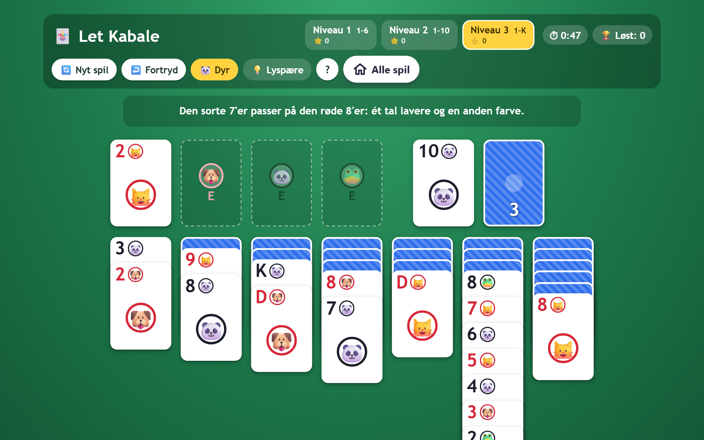

# Let Kabale (EasySolitaire)


[](LICENSE)
[](https://github.com/kreaton/EasySolitaire/stargazers)

⭐ If Let Kabale earns a place on your machine, [star it on GitHub](https://github.com/kreaton/EasySolitaire) — it's free, made by one developer, and stars are how other people find it.



**A kid-friendly Klondike solitaire, with three levels and cute animals instead of suits.**

▶️ **Play it:** <https://kreaton.github.io/KidsGames/easysolitaire/>

It is a Blazor WebAssembly app (.NET 10) that runs entirely in the browser, with no server or backend, and can be installed to an iPad/phone home screen as a PWA. The game itself is in Danish (*let kabale* means "easy solitaire").

## How to play

| Level | Cards | Columns |
|------:|-------|--------:|
| 1 | 1–6 (24 cards) | 3 |
| 2 | 1–10 (40 cards) | 5 |
| 3 | 1–K (52 cards) | 7 |

* Turn **one** card at a time from the deck; the deck can be flipped back over as often as you like.
* In the columns, put a card on a card that is **one number higher and the other colour**. An empty column only takes the highest card (6 / 10 / K).
* The four **home piles** at the top left, one per animal (or suit), count up from 1.
* **Tap the turned card** or **a card in a column** (it takes the cards lying on it along) to move it.
  With only one place it fits, it goes straight there. With several, the card lifts up and a 👇 hand points at
  every home pile and column it may go to; tap the one you want, or tap the card again to put it back down.
* **Tap the top card of a home pile** to take it back down onto a column.
* Cards fly to where they land and give a little wiggle there; hidden cards flip over when they are uncovered
  (switched off when the device asks for reduced motion).
* With **💬 Tekst** on, a short Danish sentence after every move explains *why* it was allowed, to teach the rules
  (*"Den røde 5'er passer på den sorte 6'er: ét tal lavere og en anden farve."*).
* Made a wrong move? **Fortryd** (undo).

The top row is laid out as home piles, a small gap, the turned card and then the deck, with the home piles lined up over the first column.

Switches in the top bar:

* **🐼 Dyr** (animals, on by default): a cat and a dog in a red ring, a panda and a frog in a black ring, instead of ♥ ♦ ♠ ♣.
* **💡 Lyspære** (light bulb, off by default): lights up when the turned card can be played, and the places it fits glow.
* **💬 Tekst** (text, off by default): shows the explanation line under the top bar. The game is made for children from 5 who can't read yet, so it is hidden unless a grown-up switches it on (screen readers still get it).

The picture cards on level 3 use the Danish letters **E B D K** (es, bonde, dame, konge). The timer starts on the first move; solved games and best times are kept per level in the browser (localStorage).

Deals are pre-checked with a small solver, so (almost) every game can be won.

## Requirements

- .NET 10 SDK (`dotnet --list-sdks` should list a `10.0.x` version)
- A trusted HTTPS dev certificate for the https URL:

  ```bash
  dotnet dev-certs https --trust
  ```

## Running locally

```bash
dotnet run --project src/EasySolitaire
```

Then open <http://localhost:5080> (or <https://localhost:7080>). In Visual Studio, open `EasySolitaire.slnx` and press F5; the `EasySolitaire` launch profile opens the browser automatically.

The engine tests are a plain console app that needs no test framework:

```bash
dotnet run --project tests/EasySolitaire.EngineTests
```

They check the rules and replay every solver solution through the real rules, to prove that the "winnable" check is honest.

## Publishing

Pushing to `main` runs the engine tests, builds the app and puts it in the `easysolitaire/` folder of the KidsGames GitHub Pages site (<https://kreaton.github.io/KidsGames/easysolitaire/>) with [`.github/workflows/deploy.yml`](.github/workflows/deploy.yml). It needs the repository secret `PAGES_DEPLOY_KEY`: the private half of a deploy key with write access to `kreaton/KidsGames`.

The app is served from an `easysolitaire` sub-path: `<base href>` in [`wwwroot/index.html`](src/EasySolitaire/wwwroot/index.html) is `easysolitaire`.

## Project layout

| Path | What it is |
| --- | --- |
| `src/EasySolitaire/Engine/GameState.cs` | The rules: columns, deck, turned cards, home piles, every place a card may go, and the moves |
| `src/EasySolitaire/Engine/Solver.cs` | Deals games and checks with a solver that they can be won |
| `src/EasySolitaire/Engine/Coach.cs` | The short Danish sentences that explain each move |
| `src/EasySolitaire/Engine/Card.cs` | Cards, suits, animals and their Danish names |
| `src/EasySolitaire/Components/Game.razor` | The board, top bar, help and win dialogs |
| `src/EasySolitaire/Components/CardView.razor` | One card |
| `src/EasySolitaire/Components/TargetButton.razor` | The tappable frame with a 👇 hand over each place a lifted card may go |
| `src/EasySolitaire/wwwroot/css/app.css` | All styling; every size scales from one `--cw` (card width) variable |
| `src/EasySolitaire/wwwroot/js/cards.js` | Card animations: cards fly to where they land and wiggle, hidden cards flip |
| `src/EasySolitaire/wwwroot/img/card-back.svg` | The back of the cards |
| `src/EasySolitaire/wwwroot/index.html` | Host page, icons and PWA meta tags |
| `src/EasySolitaire/wwwroot/manifest.webmanifest` | PWA manifest for "Add to Home Screen" |
| `src/EasySolitaire/wwwroot/icons/` | App icons and favicon |
| `tests/EasySolitaire.EngineTests` | Rule tests and the solver replay |
| `art/icon.svg` | The icon artwork |
| `tools/make-icons.ps1` | Renders the artwork to the icon sizes and copies the 512 px icon to the KidsGames front page (`KidsGames/billeder`) |

## License & Authorship

This project is distributed under the terms of the [MIT License](LICENSE).

**AI authorship note:** Most of the source code in this repository was generated with AI coding agents (Claude Code), under my direction and review. Purely AI-generated material may not be eligible for copyright protection in some jurisdictions. To the extent any part of this project is protected by copyright, it is licensed under the MIT License, and the license's warranty and liability disclaimers apply to the project as a whole.

<!-- notices:start -->
### Independent development

Let Kabale is an independent, personal project developed by Per Hejndorf. It is not affiliated with, endorsed by or sponsored by Microsoft or any other rights holder. Product names and logos are trademarks of their respective owners and are used only to identify the services and tools the project works with.

### Third-party notices and asset provenance

[THIRD-PARTY-NOTICES.md](THIRD-PARTY-NOTICES.md) lists every third-party library, font and online service the project uses, with version, licence, source and whether it was modified. It also records where the icons, images, audio and video came from and how they are licensed.
<!-- notices:end -->
